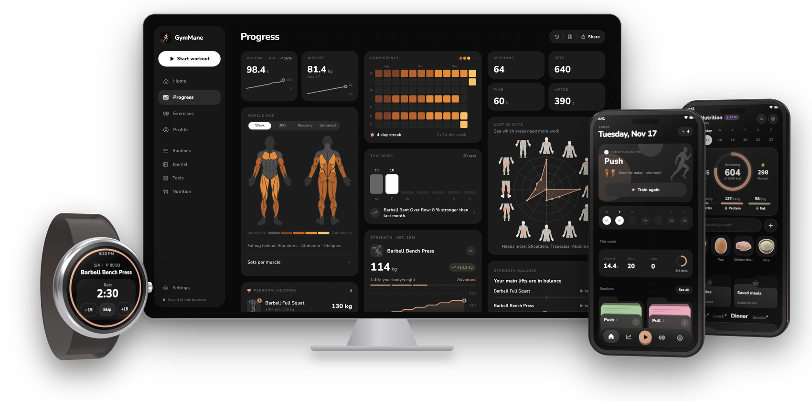

<div align="center">

# GymMane on your own server

The whole app in any browser at home, laid out for a big screen.<br/>
Your data stays in one folder on your machine. No account, no cloud.



</div>

## How it works

1. **Install it** on a machine that stays on: a NAS, a home server, a Raspberry Pi or your PC.
2. **Open the address** it gives you, like `http://192.168.1.20:8080`, from any browser at home.
3. **Optional:** share data with the GymMane phone app through Syncthing ([how](#phone-app)).

The phone app stays exactly as it is, with no internet permission at all.

## Pick your setup

| | You have | How | Time |
|:-:|---|---|:-:|
|    | Linux, Raspberry Pi 4/5, a VPS or a Mac | [One command](#linux-raspberry-pi-and-macos) | 1 min |
|  | A Windows PC | [One command](#windows) | 1 min |
|  | Proxmox VE | [One command](#proxmox-ve) | 2 min |
|  | Unraid | [Add a template](#unraid) | 2 min |
|     | Synology, QNAP, TrueNAS, CasaOS, ZimaOS | [Paste a file](#nas) | 3 min |
|   | Docker, Portainer, Dockge | [Compose or `docker run`](#docker) | 1 min |

---

## Linux, Raspberry Pi and macOS

```sh
curl -fsSL https://raw.githubusercontent.com/InlitX/GymMane/main/selfhost/install.sh | sh
```

It asks a few questions, each with a default, so you can press Enter all the way: Docker or not,
the port, a password, who will use it and, with Docker, Syncthing for the phone. Then it prints the
address and the password. GymMane starts again by itself after a reboot.

**Update or remove:** run the same command again.

<details>
<summary>More options</summary>

- No questions at all: `curl -fsSL …/install.sh | sh -s -- --yes`
- Force a mode: `--docker` or `--binary`. Add Syncthing: `--sync`. Remove: `--uninstall`.
- Without Docker it needs a 64-bit Linux (`x64` or `arm64`, so a Raspberry Pi 4/5 with a 64-bit
  system) or an Apple silicon Mac. Anything else can use [Docker](#docker).
- It opens the firewall port when run as root with `ufw` or `firewalld`.

</details>

## Windows

In PowerShell:

```powershell
irm https://raw.githubusercontent.com/InlitX/GymMane/main/selfhost/install.ps1 | iex
```

Same questions as on Linux. As administrator it starts with Windows and opens the firewall port;
without admin it starts when you log in.

**Update or remove:** run the same command again.

## Proxmox VE

In the shell of your node (Datacenter › your node › Shell):

```sh
curl -fsSL https://raw.githubusercontent.com/InlitX/GymMane/main/selfhost/proxmox.sh | sh
```

It creates a small Debian container called `gymmane` (1 core, 512 MB, 2 GB), installs GymMane in it
and prints the address and the password. The container starts with Proxmox, and its backups include
your data.

**Update:** run the same command again. **Remove:** delete the container (back it up first: your
data is inside).

<details>
<summary>Fixed IP, size and storage</summary>

Set any of these before `sh`:

| Variable | Default | |
|---|---|---|
| `GYMMANE_IP` | `dhcp` | A fixed address: `192.168.1.50/24,gw=192.168.1.1` |
| `GYMMANE_BRIDGE` | `vmbr0` | Network bridge |
| `GYMMANE_MEMORY` | `512` | MB of RAM |
| `GYMMANE_DISK` | `2` | GB of disk |
| `GYMMANE_STORAGE` | `local-lvm` | Where the disk goes |
| `GYMMANE_CTID` | next free | Container ID |

```sh
curl -fsSL https://raw.githubusercontent.com/InlitX/GymMane/main/selfhost/proxmox.sh | GYMMANE_IP=192.168.1.50/24,gw=192.168.1.1 sh
```

</details>

## Unraid

1. Docker tab › **Add Container** › Template: paste
   `https://raw.githubusercontent.com/InlitX/GymMane/main/selfhost/unraid/gymmane.xml` and press Enter.
2. Set a password (8 or more characters) and, if you like, the names of the people who will use it.
3. **Apply**, then open it from the GymMane icon › WebUI.

Your data goes to `/mnt/user/appdata/gymmane`. **Update:** from the Docker tab, like any other app.

## NAS

1. Open [`selfhost/nas/compose.yaml`](selfhost/nas/compose.yaml) and copy it all.
2. Paste it where your NAS asks for a compose file:

   | | NAS | Where |
   |:-:|---|---|
   |  | Synology DSM 7.2+ | Container Manager › Project › Create |
   |  | QNAP | Container Station › Applications › Create |
   |  | TrueNAS SCALE 24.10+ | Apps › Discover Apps › ⋮ › Install via YAML |
   |  | CasaOS, ZimaOS | App Store › + › Install a customized app › Import |

3. Write a password between the quotes of `GYMMANE_PASSWORD` (8 or more characters), start it and
   open `http://<nas-ip>:8080`.

**Update:** pull the image again and recreate it (Synology: Project › Action › Build; TrueNAS and
CasaOS: their update button).

<details>
<summary>Port taken, or data in a folder of your choice</summary>

- **Port 8080 taken:** change the first number in `ports`, for example `"8095:8080"`, and open that
  port instead.
- **Data in your own folder** (for example to sync it with the phone): the file keeps it in a Docker
  volume, which works on any NAS. Replace `gymmane-data:/data` with your folder
  (`/volume1/docker/gymmane:/data`) and add `user: "<uid>:<gid>"` with the owner of that folder
  (`id` over SSH shows it). If the folder belongs to someone else, the log says how to fix it.

</details>

## Docker

With Compose:

```sh
mkdir -p gymmane/gymmane-data/sync && cd gymmane
curl -fsSLO https://raw.githubusercontent.com/InlitX/GymMane/main/compose.yaml
echo "GYMMANE_PASSWORD=pick-something-long" > .env
docker compose up -d gymmane
```

Or in one line:

```sh
docker run -d --name gymmane -p 8080:8080 -v gymmane-data:/data --restart unless-stopped ghcr.io/inlitx/gymmane
```

Portainer and Dockge: paste [`selfhost/nas/compose.yaml`](selfhost/nas/compose.yaml) as a new stack.
Images for `amd64` and `arm64`.

**Update:** `docker compose pull && docker compose up -d`.

<details>
<summary>User ID and running without Docker</summary>

- GymMane runs as user `1000`. If yours is another (`id -u`), add `PUID=<id>` and `PGID=<group id>`
  to `.env`, and create `gymmane-data` before the first start so it belongs to you.
- **Without Docker or scripts:** download the archive for your system from the
  [latest release](https://github.com/InlitX/GymMane/releases/latest), unpack it and run
  `gymmane-server` (`start.bat` on Windows), with the `web` folder next to it. On macOS, if it is
  blocked, run `xattr -d com.apple.quarantine gymmane-server` once.

</details>

---

## Everyday use

### Several devices

Open the same address on your laptop, tablet or phone: they all share the same data, and each tab
picks up changes within 20 seconds. Browsers only offer "Install app" over HTTPS or on `localhost`;
on a plain `http://<ip>` address it works as a normal page.

### Several people

Each person can have their own data on the same address. The installers ask for the names; otherwise
add them to the [settings](#settings), separated by commas:

```sh
GYMMANE_PEOPLE="Ana María, Pablo"
```

The address then asks who is training, and each person gets their own page (`/ana-maria/`,
`/pablo/`) with their own workouts, photos and phone folder.

<details>
<summary>Passwords per person and where their data goes</summary>

- Own password after a colon: `GYMMANE_PEOPLE="Ana María:a-long-password, Pablo:another-one"`.
  Whoever has none uses `GYMMANE_PASSWORD`. Keep the quotes and use passwords without commas.
- The first person keeps the data the server already had. The others start empty, in
  `people/<name>` inside the data folder. Removing a name hides that page but never deletes data.
- Phone folder: the first person uses `gymmane-data/sync` (`/var/syncthing/GymMane` in Syncthing),
  everyone else `gymmane-data/people/<name>/sync` (`/var/syncthing/data/people/<name>/sync`).
- Prefer fully separate servers? Run one container per person, each with its own port and volume.

</details>

### Phone app

The phone and the server never connect. They share a folder through Syncthing, and each side merges
what the other leaves there.

1. **Server:** choose Syncthing in the installer, or `docker compose --profile sync up -d`. Open
   `http://<server-ip>:8384`, set a password (Actions › Settings › GUI) and add the folder
   `/var/syncthing/GymMane`.
2. **Phone:** install [Syncthing-Fork](https://f-droid.org/packages/com.github.catfriend1.syncthingandroid/),
   add the server as a device (on the server, Actions › Show ID) and accept the shared folder.
3. **GymMane on the phone:** Settings › Data & backup › Auto backup, and pick that folder.

The server merges each phone backup within 15 seconds; what you log in the browser reaches the phone
when the app opens, or right away with Auto backup › Sync now.

<details>
<summary>How merging works</summary>

- **Nothing is lost:** anything that exists on either side ends up on both.
- **Edited on both sides:** the most recent copy wins. Settings too.
- **Deleting doesn't travel:** delete it on both sides.
- The server also keeps a daily copy in `history`, just in case.
- Without Docker, install Syncthing yourself and share the server's `data/sync` folder.

</details>

### In the browser

Everything works except what browsers can't do: notifications while the tab is closed (the rest
timer still beeps while it's open), home screen widgets, and Health Connect or Apple Health.

### Updating

| Installed with | Update |
|---|---|
| Script or Proxmox | Run the same command again |
| Unraid | Docker tab › Check for updates |
| NAS | Pull the image and recreate it |
| Docker Compose | `docker compose pull && docker compose up -d` |

An update never touches your data.

---

## Settings

| Variable | Default | What it does |
|---|---|---|
| `GYMMANE_PASSWORD` | none | Password to open GymMane |
| `GYMMANE_PEOPLE` | none | Several people, each with their own data |
| `GYMMANE_PORT` | `8080` | Port |
| `GYMMANE_KEEP_DAYS` | `30` | Daily copies kept in `<data>/history` |
| `GYMMANE_SYNC` | `<data>/sync` | Folder shared with the phone. `off` turns it off |
| `GYMMANE_HOST` | `0.0.0.0` | `127.0.0.1` keeps it to this machine. Not with Docker |
| `GYMMANE_DATA` | `data` next to the server | Where data lives. In Docker it is `/data` |

| Installed with | Where | Then |
|---|---|---|
| Script, Linux or macOS | `~/gymmane/.env` (`/opt/gymmane/.env` as root) | Run the script and pick Update |
| Script, Windows | `%LOCALAPPDATA%\GymMane\gymmane.env` | Run the script and pick Update |
| Proxmox | `/opt/gymmane/.env` in the container (`pct enter <id>`) | `systemctl restart gymmane` |
| Unraid, NAS | The container variables or the compose file | Save and redeploy |
| Docker Compose | `.env` next to `compose.yaml` | `docker compose up -d` |

### Password and access from outside

With a password, GymMane asks once per browser and remembers it for a year (Settings › Data &
backup › Sign out forgets it). At home the password travels unencrypted, so to use it from outside,
go through a VPN like Tailscale or WireGuard, or a reverse proxy with HTTPS (Caddy, Traefik, Nginx
Proxy Manager). Never open the port to the internet as it is.

<details>
<summary>Building it yourself</summary>

```sh
docker build -t gymmane .
```

Or `flutter build web --wasm --release --no-web-resources-cdn` for the app and
`dart compile exe server/bin/server.dart` for the server, with `GYMMANE_WEB` pointing to `build/web`.

</details>
