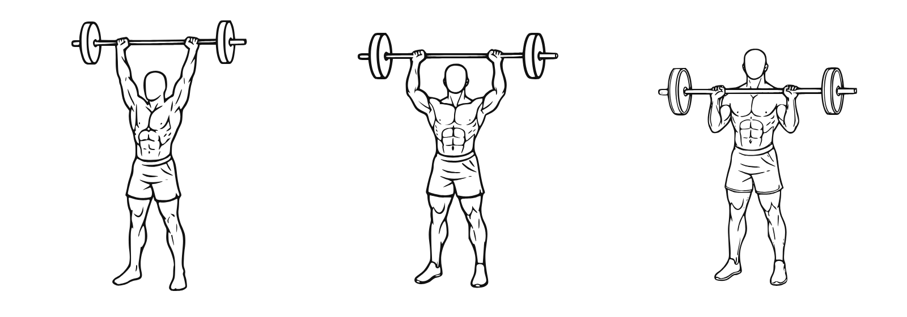
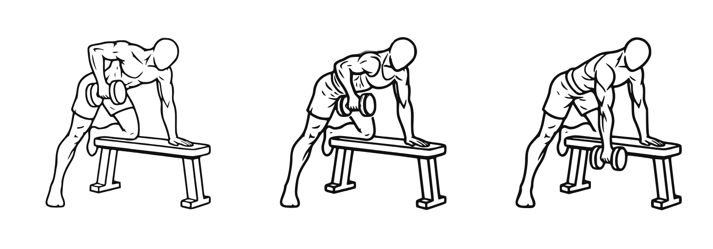
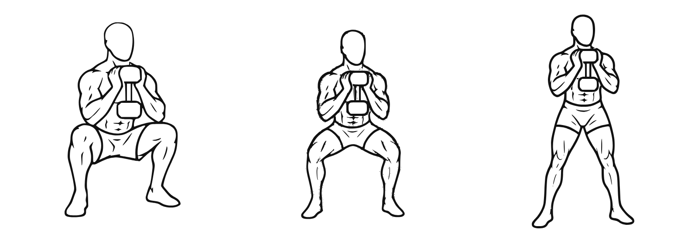

<div data-l="es">

Cada vez me llegan más mensajes pidiendo ejercicios nuevos, y tenéis razón: la biblioteca de GymMane se queda corta. En uno de esos hilos alguien preguntó si la comunidad podría ayudar a repartir el trabajo. Me pareció una idea muy buena, así que aquí va cómo funciona y cómo puedes echar una mano.

## De dónde salen los dibujos

Los dibujos de GymMane vienen de [Workout Guide](https://github.com/bryllim/workout-guide), que se basa en los de [Everkinetic](https://github.com/everkinetic/data). Los dos tienen una licencia libre, CC BY-SA 4.0, que permite usarlos en una app como esta. Es la única biblioteca gratuita que encontré con bastantes ejercicios y un estilo de dibujo que encajara, y ya están todos dentro de la app. No hay más de donde sacar.

Seguramente has visto repositorios en GitHub con más de 11.000 ejercicios, cada uno con su animación. Si lees su README, verás que esas animaciones pertenecen a Gym Visual y solo se pueden usar comprando su licencia. Ahora mismo le dedico a GymMane mi tiempo, no dinero, y no puedo pagarla. Llegué a pensar en una colecta entre todos para comprarla, pero al final preferí quedarme con lo que es libre de verdad.

También me han llegado muchos correos con zips de ejercicios y animaciones. Casi siempre tienen copyright y no puedo usarlos. Pasé mucho tiempo buscando dibujos libres y no los hay. Incluso hay quien reparte packs diciendo que son MIT o gratuitos, y cuando investigas un poco ves que no lo son.

## No son perfectos

Ya lo habrás notado: los dibujos no son perfectos. Cambian un poco de un ejercicio a otro, el cuerpo no siempre se parece entre uno y otro, y no siempre se ve bien qué músculo trabaja. Es el estilo de esta biblioteca, y es la que hemos elegido.

Si no te convence el dibujo de algún ejercicio, GymMane no te frena: entra en el ejercicio y pulsa **Añadir media** para poner tu propia imagen, GIF o vídeo, el que tú quieras.

## El plan

Que haya pocos ejercicios no es un límite, es un orden. Ahora me centro en las funciones, el diseño y en quitar fallos, y en añadir todo lo que pedís siempre que funcione sin internet.

Cuando la app esté lo bastante completa, quiero ir ejercicio por ejercicio. Cada animación son tres fotogramas que la app pasa en bucle. La idea es darle a un modelo de IA de imágenes los tres fotogramas de un ejercicio que ya existe, para que vea el estilo, y pedirle los tres de otro. Luego reviso, monto la animación y escribo los pasos. Así quiero sacar entre 50 y 100 ejercicios por versión, llegar a los 1.000 e incluso a los 5.000.

Pero he visto que a mucha gente le gusta el proyecto y quiere ayudar, y eso me ha motivado a escribir esto. Si te falta un ejercicio, puedes hacerlo tú. No hace falta saber programar. Solo hacen falta ganas y fijarse bien en los detalles.

## Cómo hacer un ejercicio

### 1. Coge los ejemplos

Estos son tres ejercicios de la app, cada uno con sus tres fotogramas. Pulsa **Descargar** en cada uno o hazles una captura. Con los tres, la IA entiende mejor el estilo.







### 2. Pídeselo a una IA de imágenes

Vale cualquiera que acepte imágenes de referencia: ChatGPT, Gemini con Nano Banana, Grok, Microsoft Copilot, Midjourney, Flux o la que uses. Con ChatGPT suele bastar.

No hay un prompt que funcione siempre: a veces sale bien a la primera y a veces hay que repetir. Pásale las tres imágenes y escribe algo así, en inglés:

```text
These images show three exercises, each one drawn as three frames.
Draw [exercise name] in exactly the same style: the same person,
the same black line art on a white background, no colours, no shading.
Don't add a face, hair or anything that isn't in the examples.
Give me three frames side by side: the start, halfway and the end.
Same camera angle, same size and same place in all three,
so only the parts that move change.
```

Cambia `[exercise name]` por el ejercicio que quieres, por ejemplo `incline hammer curl`.

### 3. Revísalo

Aquí está tu parte, y es la más importante. Imagina los tres fotogramas uno detrás de otro: la app los pasa del 1 al 3 y vuelta atrás, fundiendo uno con otro. Mira que:

- El estilo es el de los ejemplos: sin cara, sin pelo, sin colores, sin que parezca una foto.
- El cuerpo está en el mismo sitio y al mismo tamaño en los tres. Si salta de un lado a otro, la animación se ve rara.
- No hay piernas giradas, brazos de más ni manos raras.
- El ejercicio está bien hecho, con la máquina o el material correcto, y no es otro ejercicio inventado.

Si algo falla, pídele que lo corrija o vuelve a generarlo. Si está bien, ya lo tienes.

### 4. Mándamelo

Abre un issue en [GitHub](https://github.com/InlitX/GymMane/issues/new/choose) con la plantilla **New exercise**: pon el nombre del ejercicio y adjunta la imagen. Yo recorto los fotogramas, monto la animación y escribo los pasos, y sale en la siguiente versión.

<div class="note">
<p>Antes de hacerlo, mira en la app que el ejercicio no esté ya, a veces con otro nombre. Y usa como referencia solo los dibujos de GymMane, nunca imágenes de otras webs o apps.</p>
<p><b>Al mandar un ejercicio, aceptas que se publique con la licencia CC BY-SA 4.0</b>, la misma que el resto de dibujos, y me das permiso para añadirlo a GymMane y retocarlo si hace falta.</p>
</div>

## Si te atascas

Pregunta en los comentarios de abajo. Yo, o alguien de la comunidad que ya lo haya hecho, te ayudará.

No hace falta que hagas muchos. Si te falta un ejercicio y lo añades, seguro que a otra persona también le hacía falta. Gracias de verdad por querer ayudar a que la biblioteca, y la app, sigan creciendo.

</div>

<div data-l="en">

More and more people are asking for new exercises, and you're right: GymMane's library falls short. In one of those threads someone asked if the community could help share the work. I loved the idea, so here's how it works and how you can lend a hand.

## Where the drawings come from

GymMane's drawings come from [Workout Guide](https://github.com/bryllim/workout-guide), which builds on [Everkinetic](https://github.com/everkinetic/data). Both use a free license, CC BY-SA 4.0, that allows using them in an app like this. It's the only free library I found with enough exercises and a drawing style that fit, and every one of them is already in the app. There's nothing left to take.

You may have seen GitHub repos with more than 11,000 exercises, each with its own animation. If you read their README, those animations belong to Gym Visual and can only be used by buying their license. Right now I put my time into GymMane, not money, and I can't pay for it. I did think about a fundraiser to buy it together, but in the end I chose to stick with what is truly free.

I've also been sent lots of emails with zips of exercises and animations. Almost always they're copyrighted and I can't use them. I spent a long time looking for free drawings and there aren't any. Some people even share packs saying they're MIT or free, and when you dig a little you find out they aren't.

## They aren't perfect

You've probably noticed: the drawings aren't perfect. They change a bit from one exercise to another, the body doesn't always look the same, and it isn't always clear which muscle is working. That's the style of this library, and it's the one we chose.

If you don't like the drawing of an exercise, GymMane won't stop you: open the exercise and tap **Add media** to use your own image, GIF or video, whatever you like.

## The plan

Having few exercises isn't a limit, it's a matter of order. For now I'm focused on features, design and fixing bugs, and on adding everything you ask for as long as it works without internet.

Once the app is complete enough, I want to go exercise by exercise. Each animation is three frames the app plays in a loop. The idea is to give an image AI the three frames of an exercise that already exists, so it sees the style, and ask it for three frames of another one. Then I check them, build the animation and write the steps. That way I'd like to release 50 to 100 exercises per version, reach 1,000 and even 5,000.

But I've seen that a lot of people like the project and want to help, and that's what got me to write this. If an exercise you need is missing, you can make it yourself. You don't need to know how to code. You just need to want to and to look closely at the details.

## How to make an exercise

### 1. Get the examples

These are three exercises from the app, each one with its three frames. Tap **Download** on each one or take a screenshot. With all three, the AI gets the style better.


### 2. Ask an image AI

Any of them works as long as it takes reference images: ChatGPT, Gemini with Nano Banana, Grok, Microsoft Copilot, Midjourney, Flux or whichever you use. ChatGPT is usually enough.

There's no prompt that always works: sometimes it's right the first time and sometimes you have to try again. Give it the three images and write something like this:

```text
These images show three exercises, each one drawn as three frames.
Draw [exercise name] in exactly the same style: the same person,
the same black line art on a white background, no colours, no shading.
Don't add a face, hair or anything that isn't in the examples.
Give me three frames side by side: the start, halfway and the end.
Same camera angle, same size and same place in all three,
so only the parts that move change.
```

Replace `[exercise name]` with the exercise you want, for example `incline hammer curl`.

### 3. Check it

This is your part, and it's the most important one. Picture the three frames one after another: the app plays them from 1 to 3 and back, blending one into the next. Check that:

- The style matches the examples: no face, no hair, no colours, nothing that looks like a photo.
- The body is in the same place and at the same size in all three. If it jumps around, the animation looks off.
- There are no twisted legs, extra arms or strange hands.
- The exercise is done right, with the correct machine or equipment, and it isn't a made-up exercise.

If something's wrong, ask it to fix it or generate it again. If it looks right, you're done.

### 4. Send it to me

Open an issue on [GitHub](https://github.com/InlitX/GymMane/issues/new/choose) with the **New exercise** template: write the exercise name and attach the image. I'll cut the frames, build the animation and write the steps, and it'll be in the next version.

<div class="note">
<p>Before you start, check in the app that the exercise isn't there already, sometimes under another name. And only use GymMane's drawings as a reference, never images from other sites or apps.</p>
<p><b>By sending an exercise, you agree that it's published under the CC BY-SA 4.0 license</b>, the same as the rest of the drawings, and you give me permission to add it to GymMane and touch it up if needed.</p>
</div>

## If you get stuck

Ask in the comments below. I, or someone from the community who has done it before, will help you.

You don't need to make many. If an exercise you need is missing and you add it, someone else probably needed it too. Thank you for wanting to help the library, and the app, keep growing.

</div>
