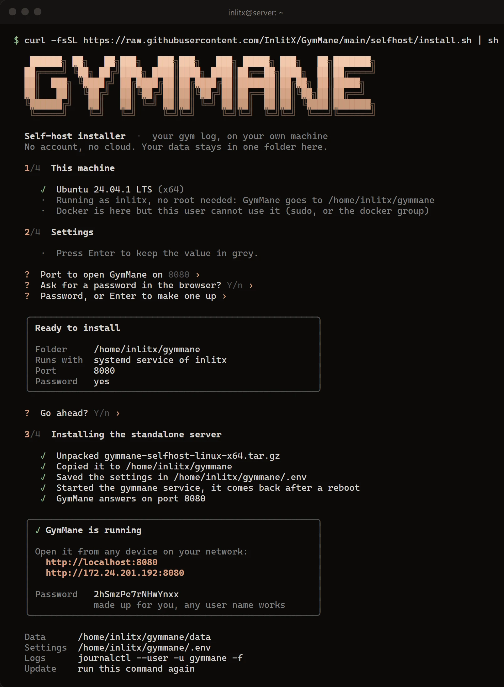

<div data-l="es">

## Qué es

Es la misma app de GymMane, con el mismo diseño y las mismas funciones, pero en el navegador: en el portátil, en el ordenador de sobremesa o en una tablet. En una pantalla grande ves a la vez tus rutinas, tu progreso y lo que has comido.

No hay ningún servidor mío de por medio. **La montas tú** en una máquina tuya: un ordenador de casa, un NAS, una Raspberry Pi o un VPS. Tus datos se quedan en una carpeta de esa máquina y cualquier navegador de tu red puede abrirla.

La app del móvil no cambia: sigue sin permiso de internet y funciona igual que siempre. Si quieres, puedes juntar sus datos con los del servidor; más abajo te explico cómo.

## Qué necesitas

<div class="note">
<p>Una máquina que esté encendida cuando quieras usarlo, con Linux, Windows o Docker. Para probar te vale tu portátil; para dejarlo siempre listo, un NAS o una Raspberry Pi 4 o 5 con sistema de 64 bits.</p>
</div>

No necesitas root ni permisos de administrador, y no hace falta abrir nada a internet.

## Instalarlo

**Linux, un VPS o una Raspberry Pi.** Copia esto en una terminal:

```sh
curl -fsSL https://raw.githubusercontent.com/InlitX/GymMane/main/selfhost/install.sh | sh
```

El instalador mira qué hay en la máquina y te hace tres o cuatro preguntas, como el puerto o si quieres contraseña. Cada una trae ya una respuesta, así que puedes ir pulsando Enter. Si tienes Docker lo usa; si no, descarga un programa que funciona solo. Al terminar te enseña la dirección que tienes que abrir y la contraseña.



Con tu usuario, se instala en tu carpeta personal y arranca solo cada vez que enciendes la máquina. Con `sudo` se instala para todo el equipo y, si tienes un cortafuegos activo, te ofrece abrir el puerto.

**Windows.** En PowerShell:

```powershell
irm https://raw.githubusercontent.com/InlitX/GymMane/main/selfhost/install.ps1 | iex
```

Te hace las mismas preguntas. Sin permisos de administrador, GymMane arranca cuando inicias sesión. Como administrador, arranca con Windows y abre el puerto en el cortafuegos.

**Docker, a mano.** Si prefieres ver cada paso:

```sh
mkdir -p gymmane/gymmane-data/sync && cd gymmane
curl -fsSLO https://raw.githubusercontent.com/InlitX/GymMane/main/compose.yaml
echo "GYMMANE_PASSWORD=algo-largo" > .env
docker compose up -d
```

El contenedor corre con un usuario normal, no como root. Por eso conviene que crees tú la carpeta de datos antes de arrancarlo, como arriba. Hay imágenes para ordenadores normales y para ARM (Raspberry Pi y la mayoría de NAS).

## Abrirlo

En la misma máquina, abre `http://localhost:8080`. Desde el móvil, una tablet u otro ordenador de casa, `http://ip-de-la-máquina:8080`; el instalador te dice cuál es. Si pusiste contraseña, el navegador te la pide. El nombre de usuario da igual.

Todos los navegadores ven los mismos datos: lo que apuntas en el portátil aparece en la tablet unos segundos después.

## Juntarlo con la app del móvil

La app del móvil nunca se conecta al servidor. Se juntan a través de una carpeta: el móvil deja ahí sus copias automáticas, el servidor deja las suyas y cada uno se trae lo nuevo del otro.

Para mover esa carpeta entre el móvil y el servidor puedes usar [Syncthing](https://syncthing.net), que va directo de un aparato a otro por tu wifi, o cualquier otra herramienta que sincronice carpetas. Con Syncthing:

<ol class="steps">
<li>En el servidor, di que sí a Syncthing en el instalador (o lanza <code>docker compose --profile sync up -d</code>). Abre Syncthing en <code>http://ip-de-la-máquina:8384</code>, ponle una contraseña y añade la carpeta <code>/var/syncthing/GymMane</code>.</li>
<li>En el móvil, instala Syncthing-Fork, emparéjalo con el servidor y acepta la carpeta.</li>
<li>En GymMane: Ajustes › Datos y copia de seguridad › Copia automática, y elige esa misma carpeta.</li>
</ol>

Si no usas Docker, instala Syncthing (o la herramienta que prefieras) por tu cuenta y apúntalo a la carpeta `data/sync` de la instalación.

Al juntarlas **nunca se pierde nada**: lo que existe en un lado acaba en los dos, y si cambiaste lo mismo en los dos sitios gana lo más reciente. Lo que no viaja es borrar: si quitas algo, quítalo en los dos.

## Ajustes

Todo se ajusta con unas pocas variables, una por línea, en el archivo de ajustes que te indica el instalador (con Docker, el `.env` junto a `compose.yaml`):

| Variable | Qué hace |
|---|---|
| `GYMMANE_PORT` | El puerto. Por defecto, `8080`. |
| `GYMMANE_PASSWORD` | La contraseña que pide el navegador. Vacía, no pide nada. |
| `GYMMANE_SYNC` | La carpeta que comparte con el móvil. `off` la apaga. |
| `GYMMANE_KEEP_DAYS` | Cuántos días de copias diarias guarda. Por defecto, 30. |

Cambia lo que quieras y vuelve a lanzar el instalador (o `docker compose up -d`). Lo que añadas se conserva al actualizar.

## Desde fuera de casa

Tal cual, GymMane está pensado para tu red de casa: la contraseña viaja sin cifrar. Si quieres entrar desde fuera, no abras el puerto a internet. Úsalo a través de una VPN como Tailscale o WireGuard, o ponlo detrás de HTTPS con Caddy, Traefik o Nginx Proxy Manager.

## Actualizar, guardar y quitar

- **Actualizar:** lanza el mismo comando y elige actualizar (con Docker, `docker compose pull && docker compose up -d`). Tus datos no se tocan.
- **Guardar:** todo está en la carpeta de datos; si la copias, lo tienes todo. Además, el servidor guarda una copia de cada día.
- **Quitar:** lanza el mismo comando y elige quitar. Tus datos se quedan en su carpeta hasta que tú la borres.

## Cómo está hecho

GymMane está hecha con [Flutter](https://flutter.dev), que compila la misma app para Android y para la web. En el servidor van dos piezas: la app web, compilada a WebAssembly para que vaya fluida, y un servidor muy pequeño escrito en Dart que guarda tus datos en una carpeta y sirve la app. No usa base de datos ni servicios externos, y todo el código es abierto.

La guía completa, con todos los detalles, está en [SELFHOST.md](https://github.com/InlitX/GymMane/blob/main/SELFHOST.md). Si algo no te funciona, cuéntamelo en [GitHub](https://github.com/InlitX/GymMane/issues).

</div>

<div data-l="en">

## What it is

It's the same GymMane app, with the same design and the same features, but in the browser: on your laptop, your desktop or a tablet. On a big screen you see your routines, your progress and what you've eaten side by side.

There's no server of mine in between. **You run it** on a machine of yours: a computer at home, a NAS, a Raspberry Pi or a VPS. Your data stays in a folder on that machine and any browser on your network can open it.

The phone app doesn't change: it still has no internet permission and works just as it always has. If you like, you can bring its data together with the server's; I explain how below.

## What you need

<div class="note">
<p>A machine that's on when you want to use it, running Linux, Windows or Docker. Your laptop is fine to try it; to leave it always ready, a NAS or a Raspberry Pi 4 or 5 with a 64-bit system.</p>
</div>

You don't need root or administrator rights, and you don't need to open anything to the internet.

## Installing it

**Linux, a VPS or a Raspberry Pi.** Paste this into a terminal:

```sh
curl -fsSL https://raw.githubusercontent.com/InlitX/GymMane/main/selfhost/install.sh | sh
```

The installer looks at the machine and asks three or four questions, like the port or whether you want a password. Each one comes with an answer already filled in, so you can just keep pressing Enter. It uses Docker if you have it and otherwise downloads a program that runs on its own. When it's done it shows you the address to open and the password.


As your own user, it installs into your home folder and starts on its own every time the machine boots. With `sudo` it installs for the whole machine and, if a firewall is on, offers to open the port.

**Windows.** In PowerShell:

```powershell
irm https://raw.githubusercontent.com/InlitX/GymMane/main/selfhost/install.ps1 | iex
```

It asks the same questions. Without administrator rights, GymMane starts when you log in. As administrator, it starts with Windows and opens the firewall port.

**Docker, by hand.** If you'd rather see every step:

```sh
mkdir -p gymmane/gymmane-data/sync && cd gymmane
curl -fsSLO https://raw.githubusercontent.com/InlitX/GymMane/main/compose.yaml
echo "GYMMANE_PASSWORD=something-long" > .env
docker compose up -d
```

The container runs as a normal user, not as root. That's why it's best to create the data folder yourself before starting it, as above. There are images for regular computers and for ARM (Raspberry Pi and most NAS boxes).

## Opening it

On the same machine, open `http://localhost:8080`. From your phone, a tablet or another computer at home, `http://machine-ip:8080`; the installer tells you which one. If you set a password, the browser asks for it. Any user name works.

Every browser sees the same data: what you log on the laptop shows up on the tablet a few seconds later.

## Bringing in the phone app

The phone app never connects to the server. They meet through a folder: the phone leaves its automatic backups there, the server leaves its own, and each side brings in what's new from the other.

To move that folder between the phone and the server you can use [Syncthing](https://syncthing.net), which goes straight from one device to the other over your Wi-Fi, or any other tool that syncs folders. With Syncthing:

<ol class="steps">
<li>On the server, say yes to Syncthing in the installer (or run <code>docker compose --profile sync up -d</code>). Open Syncthing at <code>http://machine-ip:8384</code>, give it a password and add the folder <code>/var/syncthing/GymMane</code>.</li>
<li>On the phone, install Syncthing-Fork, pair it with the server and accept the folder.</li>
<li>In GymMane: Settings › Data &amp; backup › Auto backup, and pick that same folder.</li>
</ol>

Not using Docker? Install Syncthing (or whichever tool you prefer) yourself and point it at the install's `data/sync` folder.

When they merge **nothing is lost**: whatever exists on one side ends up on both, and if you changed the same thing in both places the most recent one wins. What doesn't travel is deleting: if you remove something, remove it on both.

## Settings

Everything is set with a few variables, one per line, in the settings file the installer points you to (with Docker, the `.env` next to `compose.yaml`):

| Variable | What it does |
|---|---|
| `GYMMANE_PORT` | The port. `8080` by default. |
| `GYMMANE_PASSWORD` | The password the browser asks for. Empty, it asks for nothing. |
| `GYMMANE_SYNC` | The folder it shares with the phone. `off` turns it off. |
| `GYMMANE_KEEP_DAYS` | How many days of daily copies it keeps. 30 by default. |

Change what you like and run the installer again (or `docker compose up -d`). Whatever you add is kept when you update.

## From outside your home

As it is, GymMane is meant for your home network: the password travels unencrypted. If you want to reach it from outside, don't open the port to the internet. Use it through a VPN like Tailscale or WireGuard, or put it behind HTTPS with Caddy, Traefik or Nginx Proxy Manager.

## Updating, keeping and removing

- **Update:** run the same command and choose update (with Docker, `docker compose pull && docker compose up -d`). Your data isn't touched.
- **Keep:** everything is in the data folder; copy it and you have it all. The server also keeps a copy of every day.
- **Remove:** run the same command and choose remove. Your data stays in its folder until you delete it.

## How it's made

GymMane is built with [Flutter](https://flutter.dev), which compiles the same app for Android and for the web. The server runs two pieces: the web app, compiled to WebAssembly so it runs smoothly, and a very small server written in Dart that keeps your data in a folder and serves the app. No database, no outside services, and all the code is open.

The full guide, with every detail, is in [SELFHOST.md](https://github.com/InlitX/GymMane/blob/main/SELFHOST.md). If something doesn't work for you, tell me on [GitHub](https://github.com/InlitX/GymMane/issues).

</div>
