

Cada vez que llegaba al gimnasio hacía lo mismo: desbloquear el móvil, abrir la app, buscar la rutina del día y darle a empezar. Son pocos pasos, pero justo cuando quieres ponerte a entrenar. Quería que la app ya supiera lo que toca y me lo pusiera delante.

Así que ahora basta con acercar el móvil a una pegatina. Empezar a entrenar es más rápido y más fácil.

## Qué hace

Acercas el móvil a la pegatina y GymMane se abre con la rutina que toca hoy y sus ejercicios. La empiezas tú cuando quieras: la pegatina no arranca nada sola.

Si hoy es día de descanso, te lo dice, y puedes entrenar igualmente. Si dejaste un entreno a medias, lo retoma. La pegatina se graba una sola vez: cambia tu plan cuando quieras y siempre abrirá lo que toca ese día.

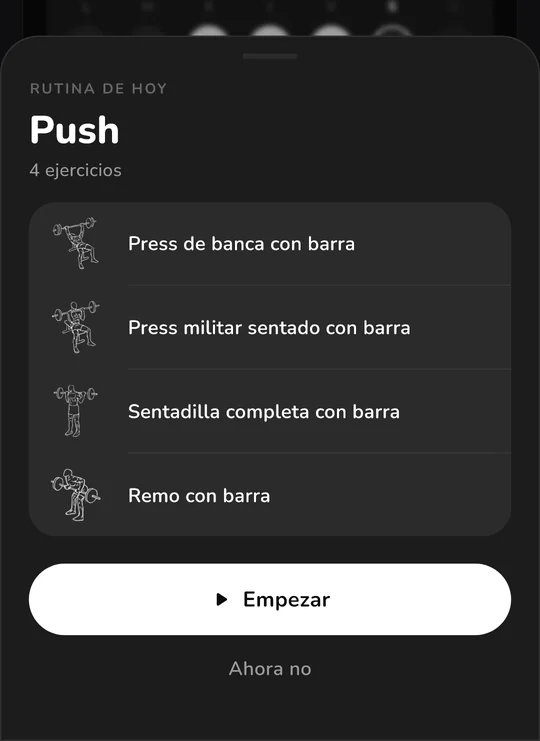
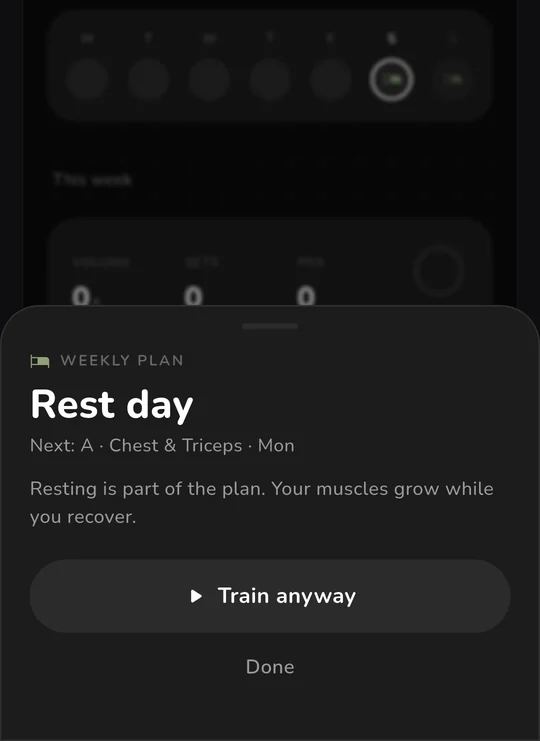

## Qué necesitas

- Un móvil Android con NFC. Casi todos lo tienen.
- Una pegatina NFC. Las mejores son las **NTAG213, 215 o 216**: funcionan en todos los móviles y cuestan muy poco.

También valen tarjetas y llaveros NFC como estos. Muchos son MIFARE Classic, que no todos los móviles leen: si la app dice que no es compatible, es cosa del móvil, y con una NTAG213 no falla.

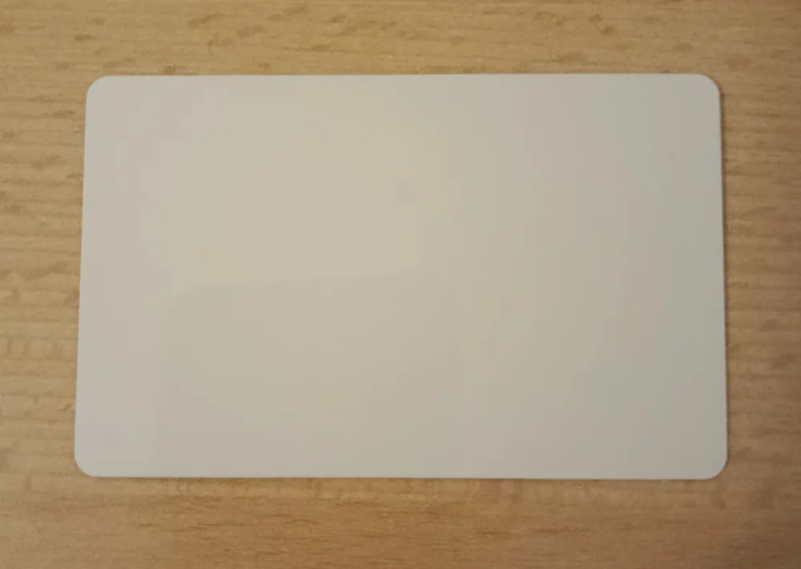
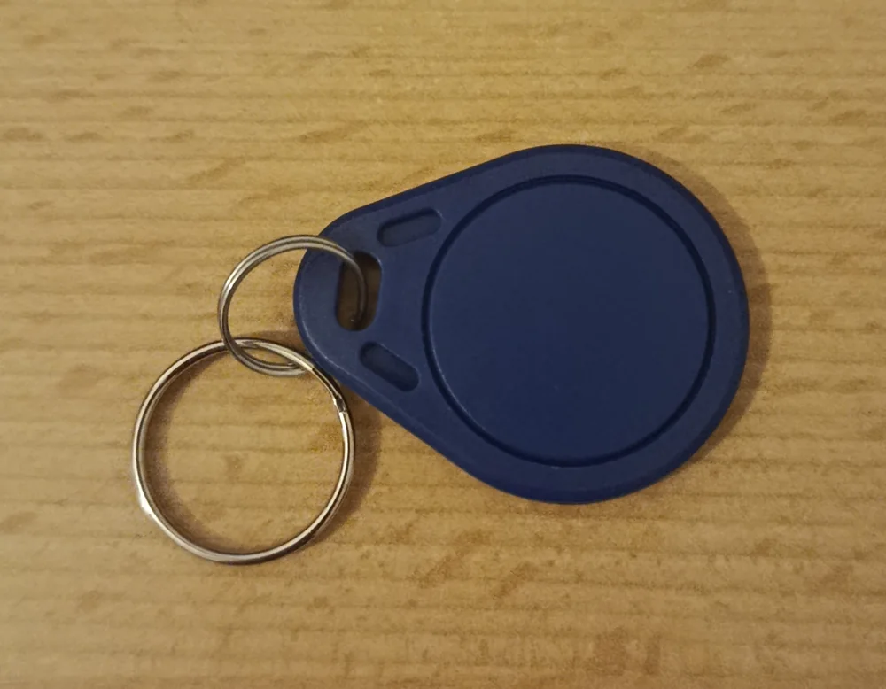

## Grabarla

<ol class="steps">
<li>En GymMane, ve a Ajustes › Entreno › <b>Pegatina NFC</b>.</li>
<li>Pulsa <b>Grabar una pegatina</b>.</li>
<li>Pon la pegatina en la parte de atrás del móvil, cerca de la cámara, y déjala quieta hasta que vibre.</li>
<li>Sale <b>Pegatina lista</b> con un check. Ya está.</li>
</ol>

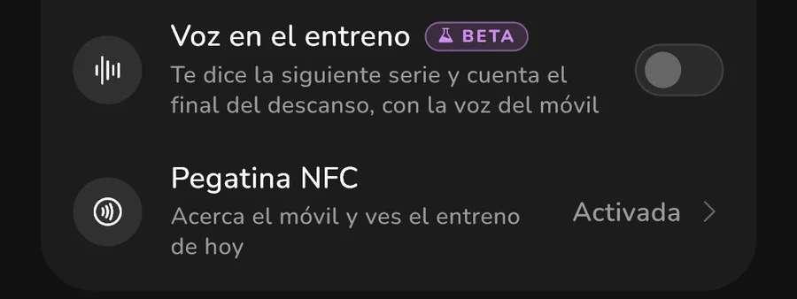

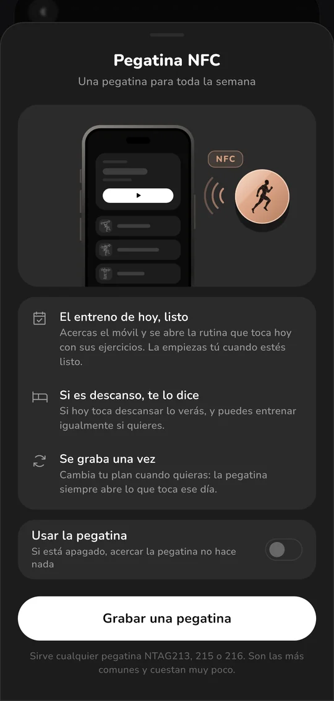

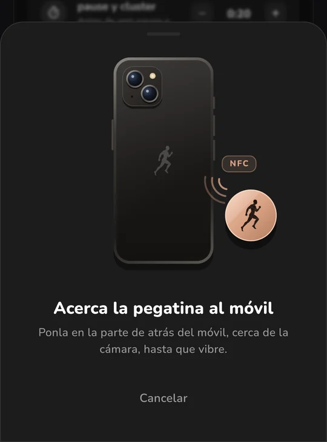
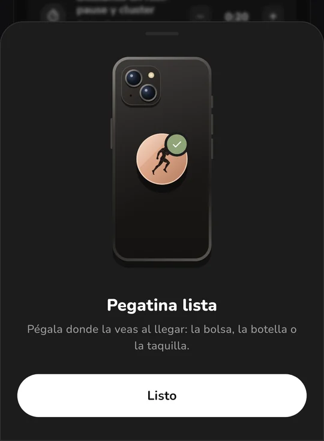

Si la mueves antes de tiempo y sale un error, vuelve a acercarla: en cuanto quede bien, pasa sola al check.

## Usarla

Llévala contigo o déjala donde entrenas: en el llavero, en la mochila o dentro de la taquilla. Con la pantalla desbloqueada, acerca el móvil y se abre GymMane. No hace falta tener la app abierta.

En algunos móviles, como los Xiaomi, Android pregunta antes de abrir la app. Pulsa **Abrir** y listo.

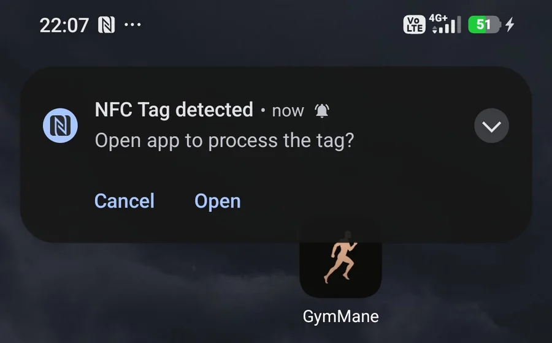

Si no quieres que la pegatina haga nada durante un tiempo, apaga **Usar la pegatina** en la misma hoja. Con el interruptor apagado, Android ni siquiera abre GymMane.

## Borrarla o usarla para otra cosa

GymMane no bloquea la pegatina, así que puedes grabarla las veces que quieras. Para borrarla o usarla en otra cosa, sirve cualquier app de NFC, como NFC Tools: «Otros › Borrar etiqueta», o graba otra cosa encima.

## Si no funciona

- **No pasa nada al acercarla:** mira que el NFC esté activado en los ajustes del móvil, que la pantalla esté desbloqueada y que **Usar la pegatina** esté encendido.
- **«Esta pegatina no es compatible»:** tu móvil no lee ese tipo de tarjeta. Usa una NTAG213.
- **«Esta pegatina está bloqueada»:** alguien la bloqueó para siempre. Usa otra.

## Cómo funciona

La pegatina no guarda tu rutina ni ningún dato tuyo. Solo lleva un enlace de unos pocos caracteres, `gymmane://today`, que cabe hasta en la pegatina más pequeña.

Al acercar el móvil, Android lee ese enlace y abre GymMane. La app mira en tu plan, que está guardado en tu propio móvil, qué rutina toca hoy y te la enseña. Por eso:

- **No necesita internet.** Todo pasa entre la pegatina y tu móvil, y GymMane ni siquiera tiene permiso de internet.
- **No hay que pasarle rutinas a la pegatina.** Si cambias de plan o de ejercicios, la pegatina sigue igual: lo que cambia está en la app.
- **Si la pierdes, no pasa nada.** Quien la lea solo verá ese enlace.
- **Una pegatina vale para varias personas.** Cada móvil abre su propio plan.

Todo el código es abierto, en [GitHub](https://github.com/InlitX/GymMane).

Every time I got to the gym I did the same thing: unlock my phone, open the app, find today's routine and tap start. It's only a few steps, but they come right when you want to start training. I wanted the app to already know what was on today and put it in front of me.

So now you just tap your phone on a sticker. Starting a workout is quicker and easier.

## What it does

Tap your phone on the sticker and GymMane opens with today's routine and its exercises. You start it whenever you want: the sticker never starts anything on its own.

If today is a rest day, it tells you, and you can still train. If you left a workout halfway, it picks it up. You write the sticker only once: change your plan whenever you like and it always opens what is planned for that day.

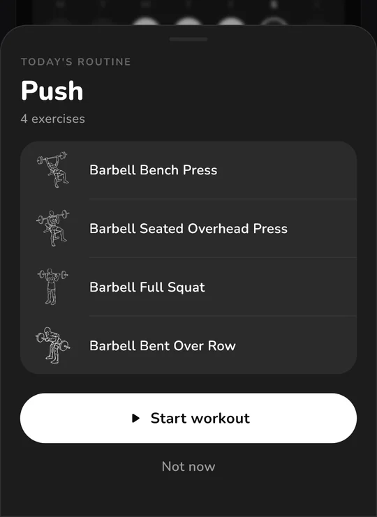

## What you need

- An Android phone with NFC. Almost all of them have it.
- An NFC sticker. The best ones are **NTAG213, 215 or 216**: they work on every phone and cost very little.

NFC cards and key fobs like these work too. Many are MIFARE Classic, which not every phone can read: if the app says it isn't supported, it's down to the phone, and an NTAG213 always works.

## Writing it

<ol class="steps">
<li>In GymMane, go to Settings › Training › <b>NFC sticker</b>.</li>
<li>Tap <b>Write a sticker</b>.</li>
<li>Hold the sticker against the back of your phone, near the camera, and keep it still until it buzzes.</li>
<li>You'll see <b>Sticker ready</b> with a check. That's it.</li>
</ol>

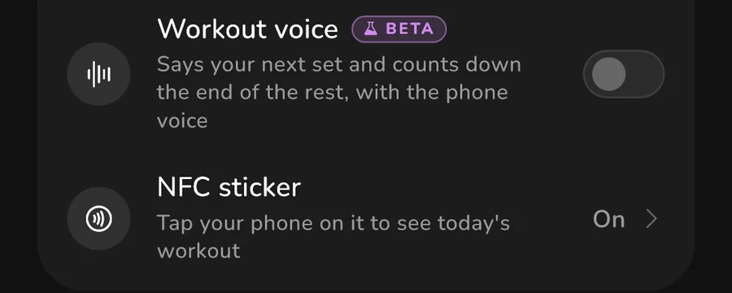

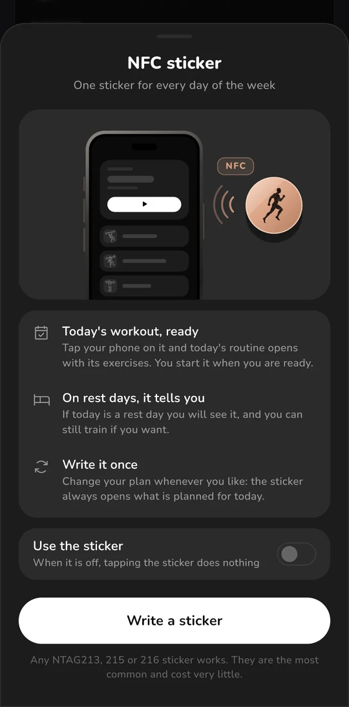

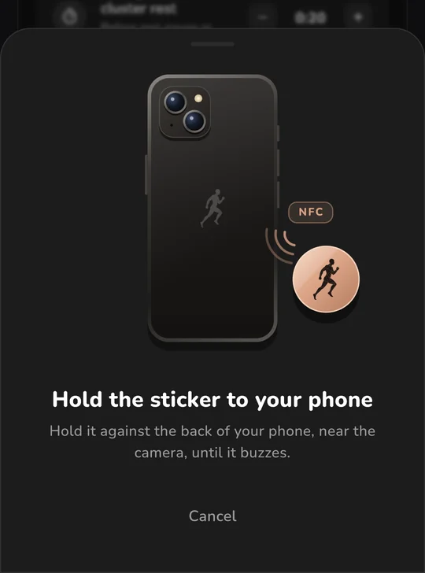
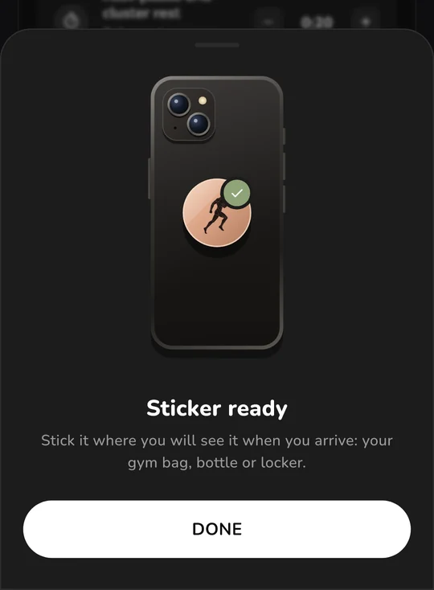

If you move it too soon and get an error, just hold it there again: as soon as it's written, it switches to the check by itself.

## Using it

Keep it with you or where you train: on your keyring, in your gym bag or inside your locker. With the screen unlocked, tap your phone on it and GymMane opens. The app doesn't need to be open.

On some phones, like Xiaomi, Android asks before opening the app. Tap **Open** and you're done.

If you don't want the sticker to do anything for a while, turn off **Use the sticker** in the same sheet. With the switch off, Android doesn't even open GymMane.

## Erasing it or using it for something else

GymMane doesn't lock the sticker, so you can write it as many times as you like. To erase it or use it for something else, any NFC app works, like NFC Tools: "Other › Erase tag", or write something else over it.

## If it doesn't work

- **Nothing happens when you tap it:** check that NFC is on in your phone's settings, that the screen is unlocked and that **Use the sticker** is on.
- **"This sticker isn't supported":** your phone can't read that kind of card. Use an NTAG213.
- **"This sticker is locked":** someone locked it for good. Use another one.

## How it works

The sticker doesn't hold your routine or any of your data. It only carries a link a few characters long, `gymmane://today`, which fits on even the smallest sticker.

When you tap your phone on it, Android reads that link and opens GymMane. The app checks your plan, which is saved on your own phone, sees which routine is on today and shows it to you. That's why:

- **It doesn't need internet.** Everything happens between the sticker and your phone, and GymMane doesn't even have internet permission.
- **You never copy routines onto the sticker.** If you change your plan or your exercises, the sticker stays the same: what changes lives in the app.
- **If you lose it, nothing happens.** Whoever reads it only sees that link.
- **One sticker works for several people.** Each phone opens its own plan.

All the code is open source, on [GitHub](https://github.com/InlitX/GymMane).

